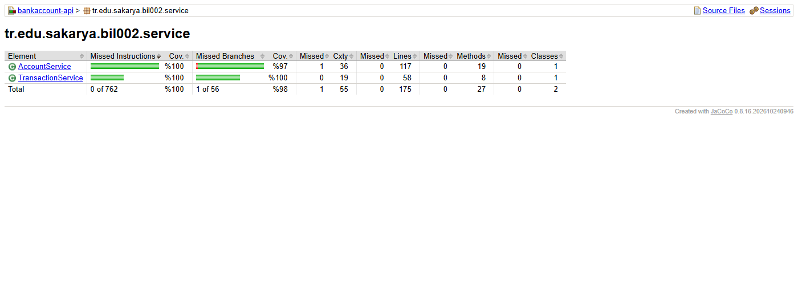
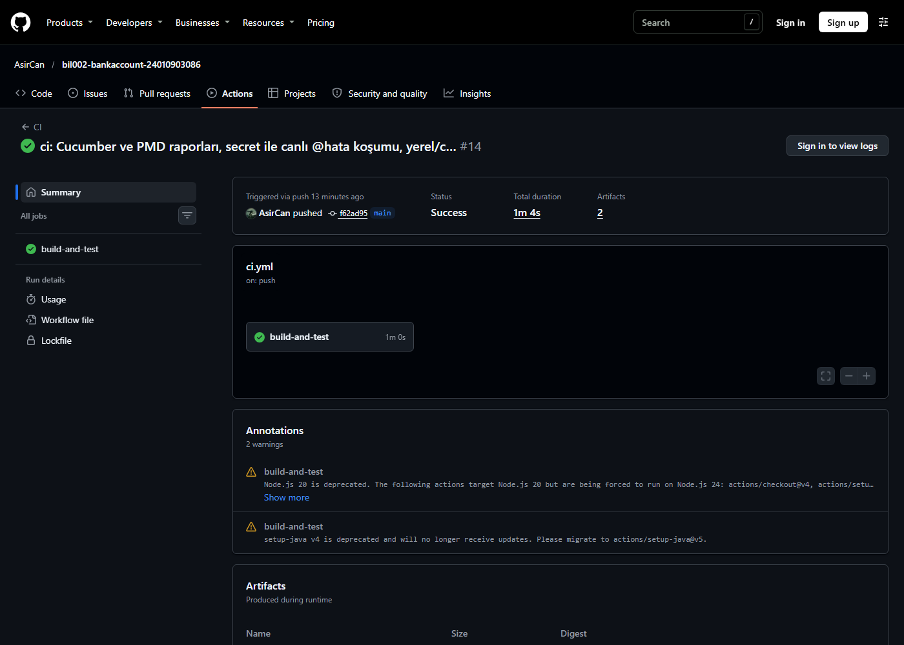

# BIL 002 Dönem Projesi Test Raporu

| | |
|---|---|
| **Öğrenci Adı** | _<Adın Soyadın>_ |
| **Öğrenci No** | 24010903086 |
| **Tarih** | Aralık 2026 |
| **Kısım 1 Repo URL (BankAccount)** | https://github.com/AsirCan/bil002-bankaccount-24010903086 |
| **Kısım 2 Repo URL (Selenium + Cucumber)** | https://github.com/AsirCan/bil002-selenium-24010903086 |

> Bu rapor BYS üzerinden teslim edilir (son tarih: 18 Aralık 2026 Cuma). Bölüm 1–10 Kısım 1'i, en sondaki
> Kısım 2 başlığı Selenium/Cucumber çalışmasını kapsar.

## Proje yapısı hakkında not

Bu projede şablon repo verilmedi. Hatalı uygulama yalnızca canlı serviste (`lab.mykucukkara.com`) çalışıyor. Bu yüzden:

- `src/main` altında **Gereksinimler belgesinden yazdığımız referans API** var. Beyaz kutu, kapsama, TDD ve
  MockMvc testleri bu kod üzerinde yapıldı. Referans koda bilerek hata konmadı.
- Kara kutu / BDD / API testleri **yalnızca gereksinimlerden** tasarlandı ve HTTP üzerinden çalışıyor. Aynı testler
  hem yerelde (referans API, `./mvnw test`) hem canlı serviste (`./mvnw test -Dhedef=canli`, token ortam
  değişkeninden) koşuldu. **Yerelde geçip canlıda kalan test, canlı servisin gereksinimden saptığının kanıtıdır** ve
  `@Tag("hata")` / `@hata` ile işaretlendi.
- Gereksinim belgesi: [docs/GEREKSINIMLER.pdf](GEREKSINIMLER.pdf) (ödev PDF'inin 11–22. sayfaları, değiştirilmeden).
- Canlı servis koşum özeti: [docs/canli/canli-kosum-25-11-2026.md](canli/canli-kosum-25-11-2026.md) (112 test, 26 `@hata` kırmızı, diğerleri yeşil).

**Genel sayılar:** 186 otomatik test (JUnit + Cucumber senaryo koşumları) · 34 BDD senaryo koşumu · 28 Postman isteği ·
3 JMeter senaryosu · **14 bulunan hata (H-01 … H-14)** · service paketinde dal kapsaması **%98,4**.

---

# KISIM 1 — BankAccount API Testleri

## 1. Statik Test Sonuçları

### 1.1 Gereksinim belgesinin gözden geçirilmesi (review)

Test tasarımından önce Gereksinimler belgesi, kod çalıştırılmadan **gözden geçirildi**. Bu bir statik testtir: belgedeki
belirsizlikler en ucuz aşamada (gereksinim, ×1) yakalanır. İnceleme türü: kontrol listesi destekli **gayri resmi inceleme**
(2 kişi, bulgular kayıt altına alındı). Kontrol listesi: *Her kural test edilebilir mi? Sınırlar dahil mi hariç mi açık mı?
İki kural aynı anda ihlal edilirse ne olur? Kayıt (Transaction) oluşur mu? Hangi HTTP kodu döner?*

**Kural:** Belge bir şeyi söylemiyorsa testimiz o konuda varsayım yapmaz. Sadece belgenin açıkça söylediğini
doğrular ("reddedilmeli, bakiye değişmemeli"). Belirsiz bir noktadaki davranış hata olarak raporlanmaz.

| # | Yer | Belirsizlik / gözlem | Önem | Testte nasıl ele alındı |
|---|---|---|---|---|
| 1 | §5, §7 | İki kural aynı anda ihlal edilirse (ör. FROZEN hesaba −5 TL yatırma: 400 mü 409 mu?) hangi kodun öncelikli olduğu belirtilmemiş | Orta | Bu kombinasyonlarda yalnızca "reddedildi (4xx), bakiye ve durum değişmedi" doğrulanır, kod doğrulanmaz (KT-05, ST-18, ST-19) |
| 2 | §6 | Reddedilen **transfer** ve reddedilen **faiz** için işlem kaydı oluşup oluşmayacağı tabloda yok. Tablo sadece yatırma/çekme redlerinde FAILED kayıt istiyor | Orta | Bu durumlarda kayıt sayısı doğrulanmaz, sadece G-4 (bakiye/durum) doğrulanır |
| 3 | G-1, G-2 | 0,01'den küçük kuruş içeren tutarın (ör. 10,005 TL) kabul mü, red mi, yuvarlama mı olacağı belirtilmemiş | Düşük | Test değerleri her zaman 2 ondalıklı seçilir |
| 4 | R-1.1 | Başında/sonunda boşluk olan adın ("  Ayşe ") kırpılıp kırpılmayacağı belirtilmemiş | Düşük | Sadece "kabul edilir" doğrulanır, saklanan ad doğrulanmaz |
| 5 | R-1.4, Bölüm 3 | initialBalance için üst sınır yok: STANDARD hesap 1.000.000 TL ile açılabilir (yatırma limiti açılışa uygulanmaz) | Bilgi | Belgeye uygun davranış: kabul edilmeli (garip görünse de hata değildir) |
| 6 | R-4.8, Bölüm 3 | Transfer için limit yok: STANDARD hesaba tek transferle 10.000 TL'den fazla para gelebilir | Bilgi | Belgeye uygun davranış: kabul edilmeli, testi var (KT-12) |
| 7 | R-8.3, R-8.5 | Bakiye 0 iken faiz 0,00 olur (örnek tabloda var). 0,00 tutarlı INTEREST kaydının oluşması R-8.5'e göre beklenir | Bilgi | R-8.5'e göre kayıt beklenir |
| 8 | R-8.3 | "Yarım yukarı" yuvarlama ondalıklı sayı (Double) ile yapılırsa 0,005 gibi değerler 0,00'a düşebilir | Risk | Yuvarlama sınırı için ayrı BVA testi (BVA-10) → canlıda H-04'ü yakaladı |
| 9 | R-9.3 | Aynı zaman damgalı iki işlemin sırası belirtilmemiş | Düşük | Sıralama testinde işlemler arasında zaman farkı bırakılır (EP-19); referans API'de ikinci anahtar id (WB-05) |
| 10 | G-6 | "Gün" sunucunun yerel saatine göre. Canlı sunucunun saati **UTC** çıktı (gün 03:00 TR'de değişir) | Risk | Günlük limit testleri o saat civarında koşulmaz; gün değişimi beyaz kutuda zaman kontrollü test edildi (WB-01, WB-02) |
| 11 | §6 dipnot | FAILED kayıt yalnızca "var olan hesap + sayısal amount + iş kuralı reddi" için. Eksik/bozuk amount (400) için kayıt oluşmaz | Bilgi | EP-20'de kayıt oluşmadığı doğrulanır |

### 1.2 Statik analiz araçları (Checkstyle, PMD)

Hocanın kodu elimizde olmadığı için statik analiz **referans kodumuz** üzerinde yapıldı.

| Araç | Kapsam | Sonuç |
|---|---|---|
| Checkstyle 10.26 (`config/checkstyle/checkstyle.xml`) | `src/main` + `src/test` | **0 ihlal** (CI'da her push'ta zorunlu adım) |
| PMD 3.26 (bestpractices, errorprone, design) | `src/main` | **47 bulgu**, ayrıntı: [docs/statik/pmd-bulgular.md](statik/pmd-bulgular.md) |

| # | Araç | Dosya:Satır | Kural / Bulgu | Önem | Yorum |
|---|---|---|---|---|---|
| 1 | PMD | service/TransactionService.java:106 | CyclomaticComplexity: `transfer` metodunun karmaşıklığı **11** | Orta | **Geçerli bulgu.** Hafta 3 notundaki eşik 10. Eksik alan kontrolü (3 koşul) + 5 kural tek metotta. İyileştirme: doğrulamalar ayrı metoda alınabilir. Bu metot karar tablosu (KT-01…KT-10) ve beyaz kutu (WB-04) ile yoğun test edildi |
| 2 | PMD | exception/*.java (6 dosya) | MissingSerialVersionUID | Düşük | Geçerli ama etkisiz: istisnalar serileştirilmiyor |
| 3 | PMD | service/AccountService.java:94, 123 | ExceptionAsFlowControl (3) | Bilgi | **Bilinçli tasarım:** reddedilen yatırma/çekmede FAILED kaydı (R-2.7, R-3.8) yazmak için iş kuralı istisnası yakalanıp yeniden fırlatılıyor |
| 4 | PMD | service/AccountService.java:29 | TooManyMethods | Düşük | Servis 10 işlemi (R-1 … R-8) içeriyor; ayrılabilir ama okunurluk için tek sınıfta tutuldu |
| 5 | PMD | service/*.java (31 yer) | LawOfDemeter | Bilgi | **Yanlış alarm (false positive):** basit getter zincirleri (`account.getAccountType().getDepositLimit()`) |
| 6 | PMD | model/Account.java, Transaction.java | DataClass | Bilgi | Yanlış alarm: model sınıfları bilerek sadece veri tutuyor |
| 7 | PMD | service/AccountService.java:198, 201 | AvoidLiteralsInIfCondition | Düşük | `"STANDARD"`/`"PREMIUM"` karşılaştırması; enum adından okunabilirdi |
| 8 | PMD | BankAccountApplication.java:12 | UseUtilityClass | Bilgi | Yanlış alarm: Spring Boot giriş sınıfı |

**Yorum:** Statik analiz kodu çalıştırmadan kokuları ve riskli yapıları buluyor (ör. yüksek karmaşıklık), ama gereksinime
aykırı **mantık hatalarını bulamıyor**: canlıdaki 14 hatanın hiçbiri statik analizle bulunabilecek türden değil. Bulguların
çoğu yanlış alarm, bu yüzden her bulgu tek tek değerlendirildi.

## 2. Kara Kutu Test Vakaları

Testler yalnızca Gereksinimlerden tasarlandı (kod okunmadan). Konum: `src/test/java/tr/edu/sakarya/bil002/blackbox/`.
Bütün testler referans API'de ✔. Aşağıdaki **Gerçekleşen** sütunu canlı servis sonucudur. Her reddedilen işlemde ayrıca
bakiye/durumun değişmediği (G-4) doğrulandı. Gereksinim → test eşlemesi (izlenebilirlik): her test metodunun üstünde
R-x.y yorumu ve `@DisplayName`'de Test ID var.

**Senaryo sayıları:** EP 22 · BVA 10 (30 değer) · Karar tablosu 18 · Durum geçiş 23 · Eşzamanlılık 3 → **76 senaryo**.

### 2.1 Denklik Sınıfı Tablosu (`DenklikSinifiTesti`)

| Test ID | Giriş | Beklenen | Gerçekleşen (canlı) | Sonuç |
|---|---|---|---|---|
| EP-01 | Geçerli STANDARD hesap, ad dolu, bakiye 500 | 201, ACTIVE, 10 haneli no, kayıt yok (R-1.2, 1.5–1.7) | 201, ACTIVE, kayıt yok | ✔ |
| EP-02 | ownerName: `null` / `""` / `"   "` (3 geçersiz sınıf) | 400 (R-1.1) | 400 | ✔ |
| EP-03 | accountType: `"standard"`, `"GOLD"`, `""`, `null` | 400 (R-1.2) | 400 | ✔ |
| EP-04 | Geçerli PREMIUM | 201, PREMIUM | 201 | ✔ |
| EP-05 | initialBalance gönderilmez | bakiye 0 (R-1.3) | 0 | ✔ |
| EP-06 | initialBalance −100 | 400 (R-1.4) | **201, bakiye −100** | ✘ H-02 |
| EP-07 | Yatırma 500 (geçerli) | 200, bakiye +500, DEPOSIT/SUCCESS (R-2.5, 2.6) | Beklendiği gibi | ✔ |
| EP-08 | Yatırma −100 | 400, bakiye aynı, DEPOSIT/FAILED kaydı (R-2.2, 2.7) | 400, bakiye aynı, **FAILED kayıt yok** | ✘ H-03 |
| EP-09 | Olmayan hesaba yatırma | 404 (R-2.1) | 404 | ✔ |
| EP-10 | Çekme 300 (geçerli) | 200, bakiye −300, WITHDRAWAL/SUCCESS (R-3.6, 3.7) | Beklendiği gibi | ✔ |
| EP-11 | Çekme −100 | 400, bakiye aynı, WITHDRAWAL/FAILED (R-3.2, 3.8) | 400, **FAILED kayıt yok** | ✘ H-03 |
| EP-12 | Olmayan hesaptan çekme | 404 (R-3.1) | 404 | ✔ |
| EP-13 | Var olan hesap sorgusu | 200 (R-10.1) | 200 | ✔ |
| EP-14 | Olmayan hesap sorgusu | 404 (R-10.2) | **200, boş gövde** | ✘ H-01 |
| EP-15 | Faiz: belgedeki 5 örnek (S 1000, P 1000, S 12000, P 2500,50, S 0) | 1002,50 / 1004,17 / 12030 / 2510,92 / 0 (R-8.2–8.4) | **1002 / 1004** / 12030 / **2510,50** / 0 | ✘ H-04 (3 satır) |
| EP-16 | PREMIUM 1000 faiz kaydı | INTEREST/SUCCESS, amount 4,17 (R-8.5) | amount **4,00** | ✘ H-04 |
| EP-17 | Olmayan hesabın geçmişi | 404 (R-9.1) | 404 | ✔ |
| EP-18 | İşlemsiz hesabın geçmişi | 200, boş liste (R-9.4) | 200, [] | ✔ |
| EP-19 | Yatırma sonra çekme | En yeni önce: WITHDRAWAL, DEPOSIT (R-9.3) | Beklendiği gibi | ✔ |
| EP-20 | Yatırma gövdesi `{}` (amount eksik) | 400, kayıt yok (§7, §6 dipnot) | 400, kayıt yok | ✔ |
| EP-21 | Bozuk JSON gövde | 400 (§7) | 400 | ✔ |
| EP-22 | Art arda 20 hesap açma | Numaralar 10 haneli, ilk hane ≠ 0, benzersiz (R-1.5) | Beklendiği gibi | ✔ |

### 2.2 Sınır Değer Analizi Tablosu (`SinirDegerTesti`, 3-değerli BVA, adım 0,01)

| Test ID | Değişken | Sınır | Test Değeri | Beklenen | Gerçekleşen (canlı) | Sonuç |
|---|---|---|---|---|---|---|
| BVA-01 | Yatırma tutarı | > 0 | 0,00 / 0,01 / 0,02 | 400 / 200 / 200 (R-2.2) | **200** / 200 / 200 | ✘ H-05 |
| BVA-02 | STANDARD yatırma | ≤ 10.000 | 9.999,99 / 10.000,00 / 10.000,01 | 200 / 200 / 422 (R-2.4) | 200 / 200 / 422 | ✔ |
| BVA-03 | PREMIUM yatırma | ≤ 50.000 | 49.999,99 / 50.000,00 / 50.000,01 | 200 / 200 / 422 | 200 / 200 / 422 | ✔ |
| BVA-04 | Çekim (bakiye 1000) | ≤ bakiye | 999,99 / 1.000,00 / 1.000,01 | 200 / 200 / 422 (R-3.4) | 200 / **422** / 422 | ✘ H-06 |
| BVA-05 | STANDARD günlük toplam (3000 + x) | ≤ 5.000 | 4.999,99 / 5.000,00 / 5.000,01 | 200 / 200 / 422 (R-3.5) | 200 / 200 / 422 | ✔ |
| BVA-06 | PREMIUM günlük toplam (15000 + x) | ≤ 20.000 | 19.999,99 / 20.000,00 / 20.000,01 | 200 / 200 / 422 | 200 / **422** / 422 | ✘ H-07 |
| BVA-07 | initialBalance | ≥ 0 | −0,01 / 0,00 / 0,01 | 400 / 201 / 201 (R-1.4) | **201** / 201 / 201 | ✘ H-02 |
| BVA-08 | Transfer (kaynak bakiye 500) | ≤ bakiye | 499,99 / 500,00 / 500,01 | 200 / 200 / 422 (R-4.5) | 200 / 200 / 422 | ✔ |
| BVA-09 | Çekim tutarı | > 0 | 0,00 / 0,01 / 0,02 | 400 / 200 / 200 (R-3.2) | 400 / 200 / 200 | ✔ |
| BVA-10 | Faiz yuvarlama (S bakiye) | 0,005 (yarım yukarı) | 1,96 / 2,00 / 2,04 | faiz 0,00 / 0,01 / 0,01 (R-8.3) | 0,00 / **0,00 / 0,00** | ✘ H-04 |

### 2.3 Karar Tablosu (`KararTablosuTesti`)

**Tablo 1, Transfer.** 7 koşul → tam tablo 2⁷ = 128 kural. Bir koşul "Hayır" olduğunda sonuç diğer koşullardan bağımsız
olduğu için ("-" = önemsiz) tablo **10 kurala** indirgendi. Gösterim hocanın notundaki gibi: D = Doğru, Y = Yanlış, - = önemsiz.

| Koşul / Eylem | K1 | K2 | K3 | K4 | K5 | K6 | K7 | K8 | K9 | K10 |
|---|---|---|---|---|---|---|---|---|---|---|
| Kaynak hesap var mı? | D | D | D | D | D | D | D | D | **Y** | D |
| Hedef hesap var mı? | D | D | D | D | D | D | D | **Y** | - | D |
| Kaynak ACTIVE mi? | D | **Y** | D | D | **Y (CLOSED)** | D | D | - | - | D |
| Hedef ACTIVE mi? | D | D | **Y (FROZEN)** | **Y (CLOSED)** | D | D | D | - | - | D |
| Farklı hesaplar mı? | D | D | D | D | D | **Y** | D | - | - | D |
| amount > 0 mı? | D | D | D | D | D | D | D | - | - | **Y** |
| Bakiye yeterli mi? | D | - | - | - | **Y (0)** | - | **Y** | - | - | - |
| **Eylem** | 200, iki bakiye değişir, 2 kayıt | 409 | 409 | 409 | red (4xx) | 400 | 422 | 404 | 404 | 400 |
| **Test ID** | KT-01 | KT-02 | KT-03 | KT-04 | KT-05 | KT-06 | KT-07 | KT-08 | KT-09 | KT-10 |
| **Sonuç (canlı)** | ✔ | ✔ | ✘ H-11 | ✘ H-11 | ✔ | ✘ H-12 | ✔ | ✔ | ✔ | ✔ |

Ek kurallar (R-4.8): **KT-11** 5.000 TL transfer sonrası aynı gün 5.000 TL çekilebilir (transfer günlük limite sayılmaz) ✔ ·
**KT-12** STANDARD hesaba tek seferde 20.000 TL transfer kabul edilir (transfer limiti yok) ✔.
_Not:_ KT-11'in ilk sürümü transferden sonra bakiyenin tamamını çekiyordu ve H-06 yüzünden kırmızıydı (**hata maskeleme**).
Test, H-06'dan bağımsız olacak şekilde yeniden tasarlandı.

**Tablo 2, Limitler** (hesap türü × tutar × işlem). Aynı tutar, hesap türüne göre farklı sonuç vermeli:

| Koşul / Eylem | KT-13 | KT-14 | KT-15 | KT-16 | KT-17 | KT-18 |
|---|---|---|---|---|---|---|
| Hesap türü | STANDARD | STANDARD | PREMIUM | PREMIUM | STANDARD | PREMIUM |
| İşlem | yatırma | yatırma | yatırma | yatırma | çekme (günlük) | çekme (günlük) |
| Tutar | 10.000,00 | 10.000,01 | 10.000,01 | 50.000,01 | 5.000,01 | 5.000,01 |
| **Eylem** | 200 | 422 | 200 | 422 | 422 | 200 |
| **Sonuç (canlı)** | ✔ | ✔ | ✔ | ✔ | ✔ | ✔ |

### 2.4 Durum Geçiş Tablosu (`DurumGecisTesti`)

§4.2'deki tablonun **11 satırının hepsi** (geçerli + geçersiz geçişler) ve §4.3 izin matrisindeki yasak olaylar.
Her geçişte bakiyenin değişmediği de doğrulandı.

| Test ID | Başlangıç Durumu | Olay | Beklenen Durum | Gerçekleşen Durum (canlı) | Sonuç |
|---|---|---|---|---|---|
| ST-01 | ACTIVE | freeze | FROZEN (200) | FROZEN | ✔ |
| ST-02 | ACTIVE | unfreeze | ACTIVE (409) | ACTIVE, 409 | ✔ |
| ST-03 | ACTIVE, bakiye 0 | close | CLOSED (200) | CLOSED | ✔ |
| ST-04 | ACTIVE, bakiye 0,01 | close | ACTIVE (409) | **CLOSED (200)** | ✘ H-08 |
| ST-05 | FROZEN | freeze | FROZEN (409) | FROZEN, **200** | ✘ H-09 |
| ST-06 | FROZEN | unfreeze | ACTIVE (200) | ACTIVE | ✔ |
| ST-07 | FROZEN, bakiye 0 | close | CLOSED (200) | CLOSED | ✔ |
| ST-08 | FROZEN, bakiye 0,01 | close | FROZEN (409) | **CLOSED (200)** | ✘ H-08 |
| ST-09 | CLOSED | freeze | CLOSED (409) | CLOSED, 409 | ✔ |
| ST-10 | CLOSED | unfreeze | CLOSED (409) | CLOSED, 409 | ✔ |
| ST-11 | CLOSED | close | CLOSED (409) | CLOSED, 409 | ✔ |
| ST-12 | FROZEN | deposit | 409, bakiye aynı | 409 | ✔ |
| ST-13 | FROZEN | withdraw | 409, bakiye aynı | **200, bakiye 90** | ✘ H-10 |
| ST-14 | FROZEN | transfer gönder | 409 | 409 | ✔ |
| ST-15 | FROZEN | transfer al | 409, iki bakiye aynı | **200, para geçti** | ✘ H-11 |
| ST-16 | FROZEN | interest | 409 | 409 | ✔ |
| ST-17 | CLOSED | deposit | 409 | 409 | ✔ |
| ST-18 | CLOSED (bakiye 0) | withdraw | red (4xx) | 4xx | ✔ |
| ST-19 | CLOSED (bakiye 0) | transfer gönder | red (4xx) | 4xx | ✔ |
| ST-20 | CLOSED | transfer al | 409 | **200, kapalı hesaba para girdi** | ✘ H-11 |
| ST-21 | CLOSED | interest | 409 | 409 | ✔ |
| ST-22 | FROZEN / CLOSED | sorgulama + geçmiş | 200 (§4.3, R-9.4) | 200 | ✔ |
| ST-23 | ACTIVE | freeze → unfreeze → freeze → close (bakiye 0) | CLOSED, kayıt yok | Beklendiği gibi | ✔ |

**Kapsam:** Bütün durumlar (0-geçiş kapsamı) ve diyagramdaki bütün geçerli geçişler (1-geçiş kapsamı: ACTIVE→FROZEN,
FROZEN→ACTIVE, ACTIVE→CLOSED, FROZEN→CLOSED) kapsandı. Diyagramda görünmeyen **geçersiz geçişler** tablodaki
"Reddedilir" satırlarından (ST-02, 04, 05, 08–11) test edildi.

### 2.5 Eşzamanlılık (`EszamanlilikTesti`)

| Test ID | Senaryo | Beklenen | Gerçekleşen (canlı) | Sonuç |
|---|---|---|---|---|
| EZ-01 | 20 iş parçacığıyla 100 × 1 TL yatırma | Hepsi 200 ise bakiye 100 (R-2.5) | 100 yanıtın hepsi 200, **bakiye 48** | ✘ H-13 |
| EZ-02 | 60 eşzamanlı karşılıklı 10 TL transfer | Hepsi 200, A + B = 10.000 (G-5) | 1 adet **500**, toplam **10.010** | ✘ H-14 |
| EZ-03 | 50 eşzamanlı hesap açma | Numaralar benzersiz (R-1.5) | 50 benzersiz | ✔ |

## 3. Beyaz Kutu Test Sonuçları

Referans API'nin `AccountService` ve `TransactionService` kodu satır satır incelendi, her `if/else` ve koşul listelendi.
Önce kara kutu + entegrasyon testlerinin kapsaması ölçüldü (**dal %91**, 51/56), kapsanmayan dallar için beyaz kutu
testleri yazıldı (`src/test/java/.../whitebox/`, Spring'siz hızlı birim testleri, ayarlanabilir saat ile).

- **Branch Coverage (service paketi):** %98,4 (61/62 dal) · tüm proje: %97,1 (66/68)
- **Statement (Instruction) Coverage (service paketi):** %100 · Satır: %100 · tüm proje komut %98,0
- Ham veri: [docs/kapsama/jacoco.csv](kapsama/jacoco.csv)

| Metot | Dal (koşul) | Test Metodu | Kapsandı mı? |
|---|---|---|---|
| `todaysSuccessfulWithdrawals` | `WITHDRAWAL && SUCCESS && bugün` → MC/DC (n+1 = 4 durum) | `wb03_gunlukToplam_mcdc` | ✔ (önce 2 dal eksikti) |
| `todaysSuccessfulWithdrawals` | Gün değişince sıfırlanma (G-6) | `wb01_gunDegisinceLimitSifirlanir`, `wb02_geceYarisiSiniri` | ✔ |
| `transfer` | `fromAccount == null \|\| toAccount == null \|\| amount == null` (3 koşul) | `wb04_transferEksikAlan` | ✔ (önce 2 dal eksikti) |
| `transfer` | amount ≤ 0 · aynı hesap · hesap yok · durum · bakiye | KT-01 … KT-10 | ✔ |
| `getHistory` | Sıralama: zaman, eşitse id (azalan) | `wb05_ayniZamanDamgasindaSiralama`, EP-19 | ✔ |
| `createAccount` | `ownerName == null \|\| isBlank()` | `wb07_adKosulununIkiKolu`, EP-02 | ✔ |
| `parseAccountType` | "STANDARD" · "PREMIUM" · diğer/null | EP-01, EP-04, EP-03, `wb08_turNull` | ✔ |
| `createAccount` | initialBalance null / < 0 / ≥ 0 | EP-05, EP-06, BVA-07 | ✔ |
| `deposit` / `withdraw` | null amount (try dışı) · amount ≤ 0 · durum · limit/bakiye · catch → FAILED | EP-08, EP-20, BVA-01…06, `wb10_yatirmaCatchDali`, `wb11_nullTutarKayitYok` | ✔ |
| `withdraw` | `bugünküToplam + amount > limit` · FAILED kayıt limite girmez | BVA-05, BVA-06, `wb06_failedKayitLimiteGirmez` | ✔ |
| `freeze` / `unfreeze` / `close` | durum kontrolleri, `bakiye.compareTo(0) != 0` | ST-01 … ST-11, `wb09_sifirOlcekliBakiyeKapatma` | ✔ |
| `applyInterest` | durum · `divide(12, 2, HALF_UP)` | EP-15, BVA-10, `wb12_faizYuvarlama`, ST-16 | ✔ |
| `getSummary` (TDD) | SUCCESS && tip | TDD-01 … TDD-05 | ✔ |
| `generateAccountNumber` | `while (existsByAccountNumber(number))` **doğru** kolu (çakışma) | — | ✘ |

**Kapsanamayan dal ve nedeni:** `generateAccountNumber`'daki döngünün "numara zaten var, tekrar üret" kolu.
Bu kola girmek için rastgele üretecin 9 milyar olasılık içinden var olan bir numarayı tutturması gerekir. Rastgelelik
dışarıdan kontrol edilemediği için deterministik bir testle kapsanamaz. Kapsamak için üreteç enjekte edilebilir hale
getirilmeliydi (Clock'ta yaptığımız gibi); bunu bilinçli olarak yapmadık. Benzersizlik kuralı (R-1.5) yine de kara kutu
(EP-22), eşzamanlılık (EZ-03) ve JMeter S3 (200 hesap) ile doğrulandı.

**Zamana bağlı kural (G-6):** Testte bir gün beklenemez. Servisler "şimdi"yi enjekte edilen `Clock`'tan aldığı için testte
elle ileri alınabilen `AyarlanabilirSaat` (fake test double) verildi: 23:59:59 → 00:00:00 geçişinde limitin sıfırlandığı
doğrulandı (WB-01, WB-02).

## 4. TDD Uygulaması

- **Özellik:** Hesap özeti, `GET /api/accounts/{accountNumber}/summary`: toplam yatırılan, toplam çekilen, işlem sayısı.
  Mini gereksinim (S-1 … S-8): [docs/tdd/OZELLIK.md](tdd/OZELLIK.md). Test: `integration/HesapOzetiTesti` (TDD-01 … TDD-05).
- **Kırmızı (Red):** Önce 5 test yazıldı, kod yoktu. 5/5 kırmızı: `Status expected:<200> but was:<404>` (adres yok).
  Çıktı: [docs/tdd/kirmizi-cikti.txt](tdd/kirmizi-cikti.txt)
- **Yeşil (Green):** Testi geçiren en küçük kod: hesaplama doğrudan controller metodunda, sonuç `Map` olarak döndü. 5/5 yeşil.
- **Yeniden düzenleme (Refactor):** Davranış değişmeden hesaplama `TransactionService.getSummary`'ye taşındı, `Map` yerine
  tip güvenli `AccountSummary` kaydı (record) kullanıldı, controller yine kural içermiyor. Bütün takım (186 test) yeşil kaldı.
- **İlgili commit'ler:**

| Adım | Commit | Mesaj |
|---|---|---|
| 🔴 | `5df5a1e` | test(red): hesap özeti için başarısız test |
| 🟢 | `0abffa0` | feat(green): hesap özeti endpoint'i |
| 🔵 | `444d8de` | refactor: özet hesaplamasını TransactionService'e taşı |

Üç commit birlikte push edildi; CI son commit'te yeşil. Kasıtlı hata düzeltmek TDD sayılmadığı için yeni bir özellik seçildi.

## 5. BDD Senaryoları

Türkçe Gherkin (`# language: tr`), iş dili. Konum: `src/test/resources/features/`, adımlar `tr.edu.sakarya.bil002.bdd`.
Adımlar HTTP üzerinden çalıştığı için senaryolar da canlıda koşuldu. Hata yakalayan senaryolar `@hata` etiketli (senaryo
ya da Examples bloğu düzeyinde).

| Feature Dosyası | Senaryo Sayısı | Açıklama | Sonuç (yerel / canlı) |
|---|---|---|---|
| `hesap_acma.feature` | 3 (1 Senaryo taslağı, 3 örnek) | Geçerli açma, geçersiz tür (taslak), negatif bakiye `@hata` | ✔ / 1 ✘ (H-02) |
| `para_yatirma.feature` | 5 (Geçmiş + 1 taslak, 3 örnek) | Yatırma, limit sınırları (taslak), 0 TL `@hata`, FAILED kayıt `@hata`, FROZEN hesap | ✔ / 2 ✘ (H-05, H-03) |
| `para_cekme.feature` | 5 (1 taslak, 3 örnek) | Çekme, tamamını çekme `@hata`, bakiye üstü, günlük limit (taslak), FROZEN `@hata` | ✔ / 2 ✘ (H-06, H-10) |
| `transfer.feature` | 5 (Geçmiş ile) | Transfer, yetersiz bakiye, olmayan hesap, aynı hesap `@hata`, FROZEN hedef `@hata` | ✔ / 2 ✘ (H-12, H-11) |
| `hesap_durumu.feature` | 5 | Dondurma, çözme, tekrar dondurma `@hata`, kapatma + tekrar açılamama, bakiyeli kapatma `@hata` | ✔ / 2 ✘ (H-09, H-08) |
| `faiz.feature` | 2 (1 taslak, 2 Examples bloğu) | Belgedeki faiz tablosu (kuruşlu örnekler `@hata`), FROZEN hesaba faiz | ✔ / 3 ✘ (H-04) |
| **Toplam** | **25 senaryo, 34 koşum** | | Yerel 34/34 ✔ · Canlı: `@hata` dışı 22/22 ✔, `@hata` 12/12 ✘ |

## 6. Entegrasyon ve API Testleri

**MockMvc** (`AccountControllerIntegrationTest`, `TransactionControllerIntegrationTest`): 19 test, 12 endpoint'in hepsi için
başarılı + hatalı istek, durum kodu ve JSON gövdesi (§7 hata biçimi dahil) doğrulanır. Gerçek sunucu açılmaz.

**Postman** (`docs/postman/bankaccount.postman_collection.json`, 28 istek, her istekte `pm.test`, hesap numarası
`hesapNo`/`hedefNo` ortam değişkeniyle taşınır). newman ile yerelde ve canlıda koşuldu. Özetler:
[yerel](postman/sonuclar/yerel-ozet.md) · [canlı](postman/sonuclar/canli-ozet.md). Ortam (environment) dosyası token
içerdiği için repoya konmadı.

| Test ID | Metot | Endpoint | Beklenen Kod | Gerçekleşen Kod (canlı) | Sonuç |
|---|---|---|---|---|---|
| API-01 | POST | /api/accounts (geçerli) | 201 | 201 | ✔ |
| API-02 | POST | /api/accounts (bakiye yok) | 201 | 201 | ✔ |
| API-03 | POST | /api/accounts (tür "standard") | 400 | 400 | ✔ |
| API-04 | POST | /api/accounts (negatif bakiye) | 400 | 201 | ✘ H-02 |
| API-05 | GET | /api/accounts | 200 | 200 | ✔ |
| API-06 | GET | /api/accounts/{no} | 200 | 200 | ✔ |
| API-07 | GET | /api/accounts/{olmayan} | 404 | 200 | ✘ H-01 |
| API-08 | POST | /api/accounts/{no}/deposit | 200 | 200 | ✔ |
| API-09 | POST | /api/accounts/{no}/deposit (negatif) | 400 | 400 | ✔ |
| API-10 | POST | /api/accounts/{no}/deposit (bozuk JSON) | 400 | 400 | ✔ |
| API-11 | POST | /api/accounts/{no}/withdraw | 200 | 200 | ✔ |
| API-12 | POST | /api/accounts/{no}/withdraw (yetersiz) | 422 | 422 | ✔ |
| API-13 | POST | /api/accounts/{no}/interest | 200, 1303,25 | 200, 1303,00 | ✘ H-04 |
| API-14 | POST | /api/accounts/{olmayan}/interest | 404 | 404 | ✔ |
| API-15 | POST | /api/transactions/transfer | 200 | 200 | ✔ |
| API-16 | POST | /api/transactions/transfer (aynı hesap) | 400 | 200 | ✘ H-12 |
| API-17 | POST | /api/transactions/transfer (eksik alan) | 400 | 400 | ✔ |
| API-18 | GET | /api/accounts/{no}/transactions | 200 | 200 | ✔ |
| API-19 | GET | /api/accounts/{olmayan}/transactions | 404 | 404 | ✔ |
| API-20 | GET | /api/transactions/{no} | 200 | 200 | ✔ |
| API-21 | GET | /api/transactions/{olmayan} | 404 | 404 | ✔ |
| API-22 | POST | /api/accounts/{no}/freeze | 200 | 200 | ✔ |
| API-23 | POST | /api/accounts/{no}/freeze (zaten FROZEN) | 409 | 200 | ✘ H-09 |
| API-24 | POST | /api/accounts/{no}/unfreeze | 200 | 200 | ✔ |
| API-25 | POST | /api/accounts/{no}/unfreeze (ACTIVE) | 409 | 409 | ✔ |
| API-26 | POST | /api/accounts/{no}/close (bakiyeli) | 409 | 200 | ✘ H-08 |
| API-27 | POST | /api/accounts/{no}/close (bakiye 0) | 200 | 200 | ✔ |
| API-28 | POST | /api/accounts/{olmayan}/close | 404 | 404 | ✔ |

Yerel referans API'de 28/28 ✔ (45/45 doğrulama). Canlıda 22 ✔, 6 ✘. Hepsi kara kutu testlerinin bulduğu hatalarla aynı.

## 7. Performans Testi Sonuçları

JMeter 5.6.3, canlı servise karşı, komut satırından (`performans/bankaccount-yuk-testi.jmx`, token `-Jtoken` ile).
Senaryolar sırayla koştu. Sonuçlar: [performans/sonuclar/sonuc.csv](../performans/sonuclar/sonuc.csv) ve
`performans/sonuclar/html/index.html`.

| Senaryo | Kullanıcı Sayısı | Ort. Yanıt Süresi (ms) | 90p (ms) | Throughput (istek/sn) | Hata % |
|---|---|---|---|---|---|
| S1 yatırma (1 TL) + bakiye sorgulama, 60 sn | 50 | 779 | 1.308 | 42,1 | 0,00 |
| S2 karşılıklı transfer (10 TL), 30 sn | 20 | 989 | 3.263 | 15,0 | 2,10 |
| S3 hesap açma (20 × 10) | 20 | 608 | 1.291 | 15,6 | 0,00 |

**Tutarlılık kontrolleri (tearDown, JSR223 Groovy):**

| Kontrol | Beklenen | Gerçekleşen | Sonuç |
|---|---|---|---|
| S1: son bakiye = başarılı yatırma × 1 TL | 1.447 TL | **1.324 TL** (123 TL kayıp; 1.447 SUCCESS kayıt var, 112 kayıt grubu aynı `balanceAfter`'ı taşıyor) | ✘ H-13 |
| S2: A + B = 20.000 TL | 20.000 | 20.000 (bu koşumda korundu), ama **11 transfer 500** döndü. Ek küçük patlamalarda toplam 10.010 / 9.990 ölçüldü | ✘ H-14 |
| S3: 200 hesabın numarası benzersiz | 200 | 200 benzersiz, biçim hatası yok | ✔ |

**Yorum:**
- **Darboğaz:** 50 eşzamanlı kullanıcıda ortalama ~0,8 sn, p90 ~1,3 sn. Paylaşılan bir sunucuda kabul edilebilir ama
  "hızlı" değil. En kötü yanıtlar ~10 sn'ye çıkıyor (uzun kuyruk). Transferde p90 3,3 sn'ye çıkıyor: iki hesabın birlikte
  güncellendiği işlem en yavaşı, ayrıca hataların (500) hepsi transferde. Ortalama tek başına yanıltıcı olurdu, o yüzden p90'a baktık.
- **Eşzamanlılık hataya yol açtı mı? Evet, en ciddi iki hata sadece yük altında görüldü:** H-13 (kayıp güncelleme:
  eşzamanlı yatırmalar aynı eski bakiyeyi okuyup üst üste yazıyor, para kayboluyor) ve H-14 (eşzamanlı transferlerde toplam
  korunmuyor ve 500 dönüyor). Tek tek isteklerle yapılan hiçbir fonksiyonel test bunları bulamazdı.
- Aynı iki hata JUnit'te `EszamanlilikTesti` (EZ-01, EZ-02) ile de tekrarlanabilir biçimde yakalandı. Referans API'de
  (tek kilit, `synchronized`) aynı testler yeşil.

## 8. CI/CD Pipeline

`.github/workflows/ci.yml`: main/develop'a her push'ta ve PR'da çalışır.

| Adım | Ne yapar? | Kırmızı olursa |
|---|---|---|
| Statik analiz (Checkstyle) | `mvnw checkstyle:check` | Pipeline durur |
| Testler (hata etiketliler hariç) | `mvnw test -DexcludedGroups=hata` (JUnit + Cucumber) | Pipeline durur (zorunlu yeşil) |
| JaCoCo / Cucumber raporlarını sakla | Artifact olarak yükler | — |
| Hata yakalayan testler (@hata) | `-Dgroups=hata`, referans API'ye karşı | Pipeline'ı bozmaz (`continue-on-error`) |
| Hata yakalayan testler (@hata) - canlı servis | `BIL002_TOKEN` secret'ı varsa aynı testler canlıya | Pipeline'ı bozmaz; kırmızı = canlıda hata |
| Statik analiz raporu (PMD) | Bilgi amaçlı | Pipeline'ı bozmaz |
| @hata özeti (Summary) | Yerel ve canlı için koşulan / kırmızı sayıları tablo olarak | — |

Bütün commit'lerde pipeline yeşil. `@hata` testleri referans API'de yeşil, canlıda kırmızıdır; Summary sayfası iki hedefin
sonucunu yan yana gösterir.

## 9. Bulunan Hatalar

Hepsi canlı serviste bulundu, aynı testler referans API'de yeşil. Ayrıntılar ve yakalayan bütün testler aşağıda.

| Hata No | Açıklama | Hangi Teknikle Bulundu | Etki Seviyesi |
|---|---|---|---|
| H-01 | Olmayan hesap sorgusu 404 yerine 200 ve boş gövde döndürüyor | API (duman), EP, Postman | Orta |
| H-02 | Negatif başlangıç bakiyesiyle hesap açılabiliyor | EP, BVA, BDD, Postman | Yüksek |
| H-03 | Reddedilen yatırma/çekme denemeleri FAILED olarak kaydedilmiyor | EP, BDD | Düşük |
| H-04 | Aylık faiz tam liraya aşağı kesiliyor (kuruşlar kayboluyor) | EP, BVA, BDD, Postman | Kritik |
| H-05 | 0 TL yatırma kabul ediliyor | BVA, BDD | Orta |
| H-06 | Bakiyenin tamamı çekilemiyor | BVA, BDD | Orta |
| H-07 | PREMIUM hesapta günlük toplam tam 20.000 TL çekilemiyor | BVA | Orta |
| H-08 | Bakiyesi olan hesap kapatılabiliyor | Durum geçiş, BDD, Postman | Kritik |
| H-09 | Zaten FROZEN olan hesap tekrar dondurulabiliyor | Durum geçiş, BDD, Postman | Orta |
| H-10 | FROZEN hesaptan para çekilebiliyor | Durum geçiş, BDD | Yüksek |
| H-11 | FROZEN / CLOSED hedef hesaba transfer yapılabiliyor | Karar tablosu, durum geçiş, BDD | Yüksek |
| H-12 | Aynı hesaba transfer kabul ediliyor | Karar tablosu, BDD, Postman | Orta |
| H-13 | Eşzamanlı yatırmalarda kayıp güncelleme (para kayboluyor) | Performans (JMeter), eşzamanlılık | Kritik |
| H-14 | Eşzamanlı transferlerde toplam bakiye korunmuyor, 500 dönüyor | Performans (JMeter), eşzamanlılık | Kritik |

### H-01: Olmayan hesap sorgusu 404 yerine 200 dönüyor
| Alan | İçerik |
|---|---|
| İhlal edilen gereksinim | R-10.2 ("Hesap mevcut değilse 404 Not Found döner"), §7, G-3 |
| Yeniden üretme | `GET /api/accounts/9999999999` (var olmayan numara) |
| Beklenen / Gerçekleşen | 404 + §7 JSON hata gövdesi / 200 OK, boş gövde (0 bayt). Farklı numaralarla aynı. Aynı numarayla `deposit` ve `transactions` doğru şekilde 404 veriyor |
| Yakalayan test | `ApiDumanTesti.duman04_olmayanHesap404`, `DenklikSinifiTesti.ep14_olmayanHesapSorgu_404`, Postman API-07 |
| Teknik / Etki | API duman testi, EP / Orta (yanlış hata kodu) |
| Sadece canlıda / yük altında mı? | Sadece canlıda · yük gerekmiyor |

### H-02: Negatif başlangıç bakiyesiyle hesap açılabiliyor
| Alan | İçerik |
|---|---|
| İhlal edilen gereksinim | R-1.4 ("initialBalance negatif ise reddedilir") |
| Yeniden üretme | `POST /api/accounts` `{"ownerName":"Ali","accountType":"STANDARD","initialBalance":-100}` |
| Beklenen / Gerçekleşen | 400 / 201, hesap −100 TL bakiyeyle ACTIVE açılıyor. Sınır değer −0,01 de kabul ediliyor |
| Yakalayan test | `DenklikSinifiTesti.ep06_negatifBaslangicBakiyesi_reddedilmeli`, `SinirDegerTesti.bva07_baslangicBakiyesiSiniri[-0,01]`, `hesap_acma.feature` "Negatif başlangıç bakiyesiyle hesap açılamaz", Postman API-04 |
| Teknik / Etki | EP, BVA, BDD / Yüksek (iş kuralı atlanıyor) |
| Sadece canlıda / yük altında mı? | Sadece canlıda · yük gerekmiyor |

### H-03: Reddedilen yatırma/çekme FAILED olarak kaydedilmiyor
| Alan | İçerik |
|---|---|
| İhlal edilen gereksinim | R-2.7, R-3.8, §6 (reddedilen denemede DEPOSIT/WITHDRAWAL + FAILED kaydı, balanceAfter = değişmemiş bakiye) |
| Yeniden üretme | 1000 TL'lik hesaba `deposit -100` (400) ya da `withdraw -100` (400), sonra `GET .../transactions` |
| Beklenen / Gerçekleşen | 1 adet FAILED kaydı / kayıt yok. Limit aşımı (422) redlerinde de kayıt yok |
| Yakalayan test | `DenklikSinifiTesti.ep08_negatifYatirma_reddedilmeli`, `ep11_negatifCekme_reddedilmeli`, `para_yatirma.feature` "Reddedilen yatırma denemesi kayıt altına alınır" |
| Teknik / Etki | EP, BDD / Düşük (kayıt eksiği) |
| Sadece canlıda / yük altında mı? | Sadece canlıda · yük gerekmiyor |

### H-04: Aylık faiz tam liraya aşağı kesiliyor
| Alan | İçerik |
|---|---|
| İhlal edilen gereksinim | R-8.3 (faiz kuruşa, 2 ondalık, yarım yukarı yuvarlanır) ve belgedeki örnek tablo, R-8.5 |
| Yeniden üretme | STANDARD 1.000 TL hesaba `POST .../interest` |
| Beklenen / Gerçekleşen | 1.002,50 / **1.002,00**. PREMIUM 1.000 → 1.004,17 / 1.004,00 · PREMIUM 2.500,50 → 2.510,92 / 2.510,50 · INTEREST kaydı 4,17 / 4,00 · 0,005 sınırı 0,01 / 0,00. Faiz tam liraya kesiliyor |
| Yakalayan test | `DenklikSinifiTesti.ep15_faizOrnekTablosu` (3 satır), `ep16_faizKaydi_olusmali`, `SinirDegerTesti.bva10_faizYuvarlamaSiniri`, `faiz.feature` "Kuruşlu sonuçlar", Postman API-13 |
| Teknik / Etki | EP, BVA, BDD / **Kritik** (yanlış bakiye, müşteri faiz kaybediyor) |
| Sadece canlıda / yük altında mı? | Sadece canlıda · yük gerekmiyor |

### H-05: 0 TL yatırma kabul ediliyor
| Alan | İçerik |
|---|---|
| İhlal edilen gereksinim | R-2.2 ("amount <= 0 (0 dahil) reddedilir") |
| Yeniden üretme | `deposit {"amount":0}` |
| Beklenen / Gerçekleşen | 400 / 200. Negatif tutar doğru reddediliyor → sınır `<= 0` yerine `< 0` gibi. Çekimde 0 doğru reddediliyor (BVA-09 ✔) |
| Yakalayan test | `SinirDegerTesti.bva01_yatirmaAltSinir[0,00]`, `para_yatirma.feature` "Sıfır TL yatırılamaz" |
| Teknik / Etki | BVA, BDD / Orta (sınırda yanlış davranış) |
| Sadece canlıda / yük altında mı? | Sadece canlıda · yük gerekmiyor |

### H-06: Bakiyenin tamamı çekilemiyor
| Alan | İçerik |
|---|---|
| İhlal edilen gereksinim | R-3.4 ("amount <= bakiye ... Bakiyenin tamamı çekilebilir") |
| Yeniden üretme | 1.000 TL bakiyeli hesaptan `withdraw 1000` |
| Beklenen / Gerçekleşen | 200, bakiye 0 / 422 "Yetersiz bakiye". 999,99 kabul, 1.000,01 red → sınır kaymış. Transferde tam bakiye doğru kabul ediliyor (BVA-08 ✔) |
| Yakalayan test | `SinirDegerTesti.bva04_cekimBakiyeSiniri[1000,00]`, `para_cekme.feature` "Bakiyenin tamamı çekilebilir" |
| Teknik / Etki | BVA, BDD / Orta (sınırda yanlış davranış) |
| Sadece canlıda / yük altında mı? | Sadece canlıda · yük gerekmiyor |

### H-07: PREMIUM hesapta günlük toplam tam 20.000 TL çekilemiyor
| Alan | İçerik |
|---|---|
| İhlal edilen gereksinim | R-3.5, Bölüm 3 ("PREMIUM hesaptan bir gün içinde toplam tam 20.000,00 TL çekilebilir") |
| Yeniden üretme | 30.000 TL PREMIUM hesaptan aynı gün `withdraw 15000`, sonra `withdraw 5000` |
| Beklenen / Gerçekleşen | 200 / 422 "Günlük çekim limiti aşıldı". STANDARD'da tam 5.000 doğru kabul ediliyor (BVA-05 ✔), hata yalnızca PREMIUM'da |
| Yakalayan test | `SinirDegerTesti.bva06_premiumGunlukLimit[20.000,00]` |
| Teknik / Etki | BVA / Orta |
| Sadece canlıda / yük altında mı? | Sadece canlıda · yük gerekmiyor |

### H-08: Bakiyesi olan hesap kapatılabiliyor
| Alan | İçerik |
|---|---|
| İhlal edilen gereksinim | R-7.2 ("Bakiye tam olarak 0 olmalıdır. Bakiyesi olan hesap kapatılamaz") |
| Yeniden üretme | 100 TL bakiyeli hesaba `POST .../close` |
| Beklenen / Gerçekleşen | 409, durum ACTIVE / 200, CLOSED; 100 TL kapalı hesapta kalıyor. 0,01 / 0,99 / 1 TL ve FROZEN hesapta da aynı |
| Yakalayan test | `DurumGecisTesti.st04_bakiyeliAktifHesapKapatma_reddedilmeli`, `st08_...`, `hesap_durumu.feature` "Bakiyesi olan hesap kapatılamaz", Postman API-26 |
| Teknik / Etki | Durum geçiş, BDD / **Kritik** (müşterinin parası kapalı hesapta kalıyor) |
| Sadece canlıda / yük altında mı? | Sadece canlıda · yük gerekmiyor |

### H-09: Zaten FROZEN olan hesap tekrar dondurulabiliyor
| Alan | İçerik |
|---|---|
| İhlal edilen gereksinim | R-5.1, §4.2 ("FROZEN + freezeAccount → Reddedilir (zaten dondurulmuş)") |
| Yeniden üretme | Hesabı `freeze`, sonra tekrar `freeze` |
| Beklenen / Gerçekleşen | 409 / 200 (durum FROZEN kalıyor) |
| Yakalayan test | `DurumGecisTesti.st05_dondurulmusHesabiTekrarDondurma_reddedilmeli`, `hesap_durumu.feature` "Zaten dondurulmuş hesap tekrar dondurulamaz", Postman API-23 |
| Teknik / Etki | Durum geçiş (geçersiz geçiş) / Orta (yanlış hata kodu) |
| Sadece canlıda / yük altında mı? | Sadece canlıda · yük gerekmiyor |

### H-10: FROZEN hesaptan para çekilebiliyor
| Alan | İçerik |
|---|---|
| İhlal edilen gereksinim | R-3.3, §4.3 (FROZEN hesapta para çekme ✘) |
| Yeniden üretme | 100 TL hesabı `freeze` → `withdraw 10` |
| Beklenen / Gerçekleşen | 409, bakiye 100 / 200, bakiye 90. FROZEN hesaba yatırma, faiz ve transfer gönderme doğru reddediliyor; hata yalnızca çekimde |
| Yakalayan test | `DurumGecisTesti.st13_dondurulmusHesaptanCekim_reddedilmeli`, `para_cekme.feature` "Dondurulmuş hesaptan para çekilemez" |
| Teknik / Etki | Durum geçiş (izin matrisi), BDD / Yüksek (yasak işleme izin) |
| Sadece canlıda / yük altında mı? | Sadece canlıda · yük gerekmiyor |

### H-11: FROZEN / CLOSED hedef hesaba transfer yapılabiliyor
| Alan | İçerik |
|---|---|
| İhlal edilen gereksinim | R-4.3 ("Her iki hesap da ACTIVE olmalıdır"), §4.3 (transfer alma ✘), R-7.4 |
| Yeniden üretme | Hedefi `freeze` (ya da bakiye 0 iken `close`) → aktif hesaptan ona `transfer 100` |
| Beklenen / Gerçekleşen | 409, iki bakiye aynı / 200; kaynak −100, hedef +100. Kapalı hesaba para giriyor. Kaynak FROZEN ise doğru reddediliyor → hedefin durumu kontrol edilmiyor |
| Yakalayan test | `KararTablosuTesti.kt03_hedefDondurulmus_409`, `kt04_hedefKapali_409`, `DurumGecisTesti.st15_...`, `st20_...`, `transfer.feature` "Dondurulmuş hesaba transfer yapılamaz" |
| Teknik / Etki | Karar tablosu, durum geçiş, BDD / Yüksek |
| Sadece canlıda / yük altında mı? | Sadece canlıda · yük gerekmiyor |

### H-12: Aynı hesaba transfer kabul ediliyor
| Alan | İçerik |
|---|---|
| İhlal edilen gereksinim | R-4.4 ("Bir hesaptan aynı hesaba transfer reddedilir"), §7 (400) |
| Yeniden üretme | `transfer {"fromAccount":X,"toAccount":X,"amount":100}` |
| Beklenen / Gerçekleşen | 400 / 200; net bakiye değişmiyor ama hesaba 2 TRANSFER/SUCCESS kaydı yazılıyor (giden + gelen) |
| Yakalayan test | `KararTablosuTesti.kt06_ayniHesap_400`, `transfer.feature` "Bir hesaptan kendisine transfer yapılamaz", Postman API-16 |
| Teknik / Etki | Karar tablosu, BDD / Orta |
| Sadece canlıda / yük altında mı? | Sadece canlıda · yük gerekmiyor |

### H-13: Eşzamanlı yatırmalarda kayıp güncelleme
| Alan | İçerik |
|---|---|
| İhlal edilen gereksinim | R-2.5 ("yeni bakiye = eski bakiye + amount"), R-2.6 |
| Yeniden üretme | Aynı hesaba aynı anda çok sayıda `deposit 1` (JMeter S1: 50 kullanıcı × 60 sn; JUnit EZ-01: 20 iş parçacığıyla 100 istek) |
| Beklenen / Gerçekleşen | Her 200 yanıtı bakiyeye yansımalı / JMeter: 1.447 başarılı yatırma, 1.447 SUCCESS kaydı, bakiye **1.324 TL** (123 TL kayıp). 112 kayıt grubu aynı `balanceAfter`'ı taşıyor (iki istek aynı eski bakiyeyi okumuş). JUnit: 100 yanıtın hepsi 200, bakiye **48 TL** |
| Yakalayan test | `EszamanlilikTesti.ez01_esZamanliYatirma_kayipGuncellemeOlmamali`, JMeter tearDown "KONTROL S1" |
| Teknik / Etki | Performans (JMeter), eşzamanlılık testi / **Kritik** (para kaybı) |
| Sadece canlıda / yük altında mı? | **Evet, sadece eşzamanlı yük altında.** Tek tek isteklerde görünmüyor |

### H-14: Eşzamanlı transferlerde toplam bakiye korunmuyor
| Alan | İçerik |
|---|---|
| İhlal edilen gereksinim | G-5 (atomiklik: ya hepsi ya hiçbiri), R-4.6, §7 (500 yalnızca beklenmeyen durumda) |
| Yeniden üretme | İki hesap arasında aynı anda karşılıklı 10 TL transferler (20–60 paralel istek) |
| Beklenen / Gerçekleşen | Toplam sabit (10.000), geçerli transferler 200 / toplam **10.010** ve **9.990** ölçüldü (para yoktan var oldu / kayboldu), bazı istekler **500**. JMeter S2'de 525 transferden 11'i 500 |
| Yakalayan test | `EszamanlilikTesti.ez02_esZamanliTransfer_toplamKorunmali`, JMeter S2 (500 hataları) |
| Teknik / Etki | Performans (JMeter), eşzamanlılık testi / **Kritik** (yanlış bakiye) |
| Sadece canlıda / yük altında mı? | **Evet, sadece eşzamanlı yük altında** |

## 10. Sonuç ve Değerlendirme

> ✍️ **TASLAK:** Bu bölüm öğrencinin kendi değerlendirmesidir. Sunumdan önce kendi cümlelerinle gözden geçir.

**Hangi teknik hangi tür hatayı buldu?**
- **Sınır değer analizi** en verimli teknik oldu: tek başına 4 hatanın (H-05, H-06, H-07, H-04'ün yuvarlama yüzü) asıl
  yakalayıcısı. Hepsi `<` / `<=` karışıklığı türünden "duvarın dibinde" hatalar: 0 TL yatırma, tam bakiye, tam 20.000.
- **Durum geçiş testi** (özellikle tablodaki "Reddedilir" satırları ve izin matrisi) yasaklı geçişlere izin veren hataları
  buldu (H-08, H-09, H-10, H-11). Diyagramda görünmeyen geçersiz geçişleri test etmenin değerini gösterdi.
- **Karar tablosu** transferdeki koşul kombinasyonlarında hedef durumunun ve aynı-hesap kontrolünün atlandığını gösterdi (H-11, H-12).
- **Denklik sınıfları** geçersiz girdi sınıflarında (negatif bakiye, H-02) ve belgedeki örnek tabloda (faiz, H-04) işe yaradı.
- **Performans/eşzamanlılık testi**, fonksiyonel testlerin hiçbirinin bulamayacağı en kritik iki hatayı buldu (H-13, H-14).
- **Statik analiz** canlı servisteki mantık hatalarından hiçbirini bulamazdı. Kodun kalitesine dair bilgi verdi (karmaşıklık 11).

**Yalnızca belirli bir teknikle bulunabilen hatalar:** H-13 ve H-14 yalnızca eşzamanlı yük altında ortaya çıkıyor.
H-07 yalnızca PREMIUM'un tam sınır değerinde görünüyor; sınırı test etmeyen bir test takımı bunu kaçırırdı.

**Projeye yeniden başlasam neyi farklı yapardım?**
- Eşzamanlılık testlerini en başta, ilk fonksiyonel testlerle birlikte planlardım. En kritik hatalar oradaydı.
- Bir testin içinde birden fazla kuralı (ör. transfer sonrası tam bakiye çekimi) birleştirmezdim. KT-11'de bir hatanın
  diğerini maskelediğini gördük. Her test tek bir kurala odaklanmalı.
- Canlı servisin saat dilimini (UTC) baştan öğrenip zamana bağlı testleri ona göre planlardım.
- Referans uygulamada rastgele numara üretecini de enjekte edilebilir yapardım. O zaman son kapsanamayan dal da test edilebilirdi.

---

# KISIM 2 — Selenium + Cucumber (Web Otomasyonu)

Repo: https://github.com/AsirCan/bil002-selenium-24010903086

### K2.1 Seçilen Uygulama

- **Site / uygulama:** [the-internet.herokuapp.com](https://the-internet.herokuapp.com) (Elemental Selenium / Sauce Labs)
- **Neden seçildi:** Otomasyon pratiği için yapılmış, kararlı ve herkese açık bir site. CAPTCHA, 2FA ve gerçek ödeme yok,
  demo hesap sayfada veriliyor. Dinamik yükleme sayfaları explicit wait'i göstermek için ideal. Çok tercih edilen e-ticaret
  demo sitelerinden farklı, senaryolar özgün.
- **Test edilen akışlar (en az 2):** (1) Giriş / çıkış (`/login`, `/secure`), (2) Dinamik yüklenen içerik
  (`/dynamic_loading/1`, `/2`), (3) Form elemanları: açılır liste ve onay kutuları (`/dropdown`, `/checkboxes`).

### K2.2 Senaryo Tablosu

| Feature Dosyası | Senaryo Sayısı | Pozitif/Negatif | Scenario Outline? | Kısa Açıklama |
|---|---|---|---|---|
| `giris.feature` | 3 (6 koşum) | 2 pozitif, 1 negatif (4 örnek) | Evet (hatalı girişler, 4 örnek) | Geçerli giriş + başarı mesajı, hatalı kullanıcı/şifre/büyük harf/boş, çıkış |
| `dinamik_yukleme.feature` | 1 (2 koşum) | Pozitif | Evet (örnek 1 ve 2) | Start → yükleme biter → "Hello World!" (explicit wait) |
| `form_elemanlari.feature` | 3 (4 koşum) | 2 pozitif, 1 negatif | Evet (Option 1 / 2) | Açılır listeden seçim, yer tutucu seçilemez, onay kutusu durumları |
| **Toplam** | **7 senaryo, 12 koşum** | Pozitif + negatif | 3 Senaryo taslağı | Her senaryoda en az 1 doğrulama |

### K2.3 Page Object Model Yapısı

| Page Sınıfı | Sorumluluğu (hangi sayfa/eleman) |
|---|---|
| `TemelSayfa` | Ortak atası: `WebDriverWait` (10 sn) ve `gorunurOlunca`, `tiklanabilirOlunca`, `yaz` yardımcıları |
| `GirisSayfasi` | `/login`: kullanıcı adı, şifre, giriş düğmesi, bildirim kutusu (`#flash`), başlık |
| `GuvenliAlanSayfasi` | `/secure`: başlık, başarı mesajı, çıkış bağlantısı |
| `DinamikYuklemeSayfasi` | `/dynamic_loading/{n}`: Start düğmesi, yükleme göstergesi, sonuç metni |
| `FormElemanlariSayfasi` | `/dropdown` (Select) ve `/checkboxes` (onay kutuları) |

Adım tanımlarında `driver.findElement` yok, sadece page metotları çağrılıyor. Locator değişirse yalnızca ilgili page sınıfı değişir.

### K2.4 Bekleme (Wait) Stratejisi

Bütün beklemeler **explicit**: `TemelSayfa`'daki `WebDriverWait` + `ExpectedConditions` (`visibilityOfElementLocated`,
`elementToBeClickable`, `urlContains`, `invisibilityOfElementLocated`). En fazla 10 sn beklenir, eleman hazır olunca hemen
devam edilir. Dinamik yüklemede sonuç birkaç saniye sonra geldiği için kritik. `Thread.sleep` ve implicit wait kullanılmadı
(implicit ve explicit wait'i karıştırmak beklenmedik toplam bekleme sürelerine ve kararsızlığa yol açar).

### K2.5 Karşılaşılan Sorunlar ve Çözümler

> ✍️ **TASLAK:** Kendi deneyiminle gözden geçir.

| Sorun | Çözüm |
|---|---|
| Türkçe Gherkin'de "Eğer ki" anotasyonunun Java sınıf adı (`Eğerki`) Türkçe karakter içeriyor | Cucumber adımı anahtar kelimeye göre değil cümleye göre eşlediği için `@When` kullanıldı |
| Bildirim kutusunun metninde kapatma işareti (×) da geliyor | Page metodunda metin temizlendi, doğrulama sadece mesaja yapıldı |
| Dinamik yüklemede sonuç gecikmeli geliyor, sabit bekleme ya yetmiyor ya da yavaş | `visibilityOfElementLocated` ile explicit wait; ayrıca yükleme göstergesinin kaybolması doğrulandı |
| Başarısız senaryoda ne olduğu anlaşılmıyordu | `@After` kancasında ekran görüntüsü alınıp rapora ve `target/ekran-goruntuleri/` altına eklendi |
| CI'da ekran yok | `-Dheadless=true` (varsayılan) ile başsız Chrome; GitHub Actions'ta `setup-chrome` |

### K2.6 Çalıştırma Sonucu

`./mvnw test` → **Tests run: 12, Failures: 0** (yerelde ve GitHub Actions'ta headless Chrome ile).

Başarısız senaryoda kancanın aldığı ekran görüntüsü örneği (bilerek yanlış beklentiyle koşulan geçici senaryo):

